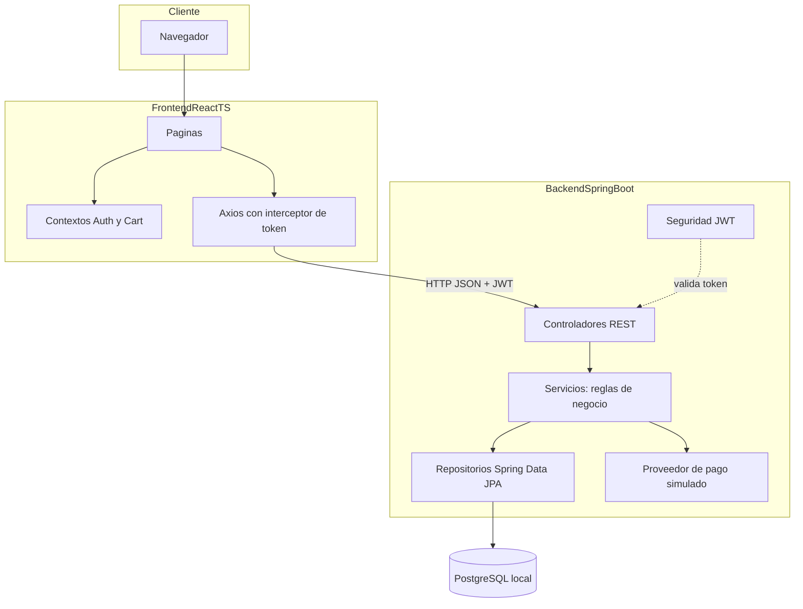
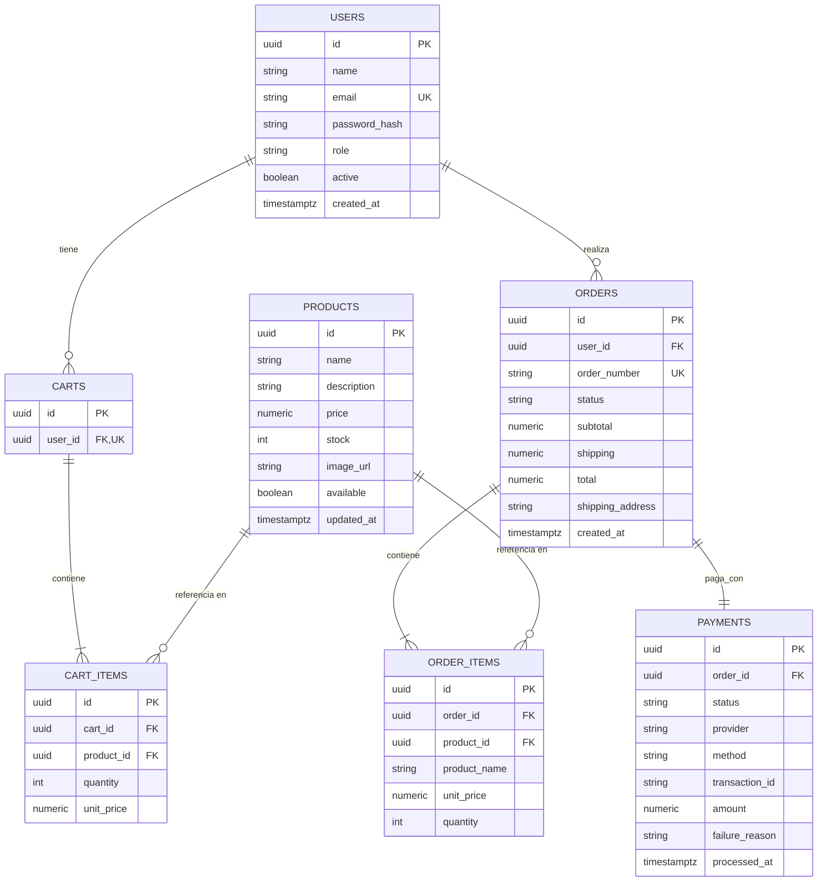
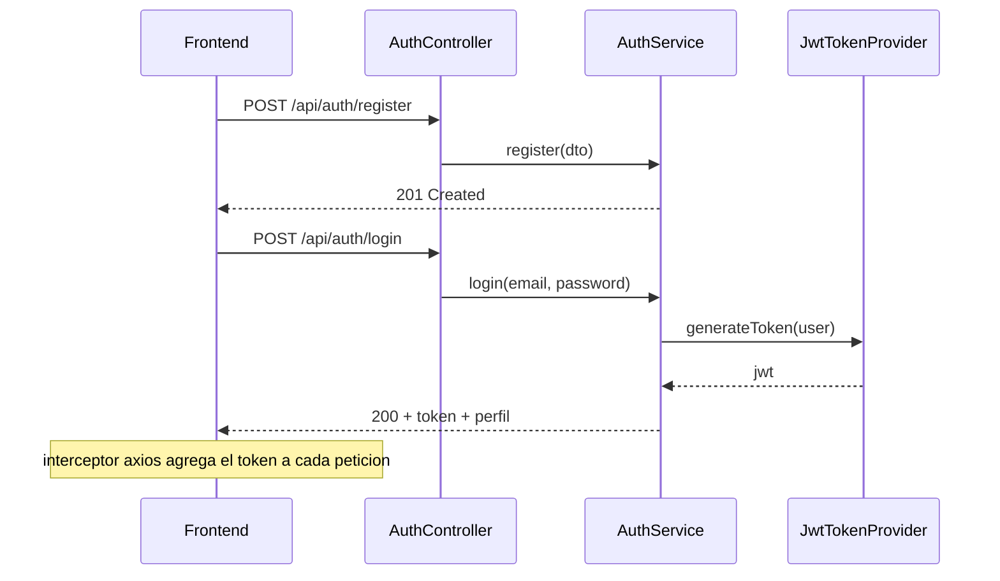

# Arquitectura — E-commerce simplificado con checkout

**Proyecto:** Prueba técnica para la asignatura **Ingeniería de Software II (Ingesoft II)**
**Stack:** Java 17 · Spring Boot 3.5 · React 18 + TypeScript · PostgreSQL
**Alcance:** MVP local, ejecutable con scripts, listo para sustentación

## 1. Resumen

Tienda online con autenticación por roles (usuario/administrador), gestión CRUD de productos y stock, carrito de compras persistente, checkout con pago simulado y trazabilidad de órdenes. La arquitectura prioriza **capas bien separadas**, **interfaces que desacoplan módulos** y **documentación como entregable**, para cumplir los criterios de evaluación (buenas prácticas, SOLID, DRY, sustentación).

### 1.1 Trazabilidad de requerimientos

| # | Requerimiento | Módulo responsable | Evidencia | Estado |
|---|---------------|--------------------|-----------|--------|
| R1 | Autenticación y gestión de usuarios segura | `backend: auth` (JWT + BCrypt) | Endpoints `/api/auth/*`, `/api/users/me` | Implementado |
| R2 | CRUD productos, stock y órdenes para administradores | `backend: catalog` con `@PreAuthorize("hasRole('ADMIN')")`; `orders` pendiente | Endpoints `/api/admin/products/**` (CRUD + stock) | Parcial (órdenes pendiente) |
| R3 | Carrito y checkout fluidos | `backend: cart` (carrito persistente con validación de stock) + `checkout` pendiente; `frontend: cart` pendiente | Endpoints `GET /api/cart`, `POST /api/cart/items`, `PATCH|DELETE /api/cart/items/{itemId}` | Parcial (carrito implementado; checkout pendiente) |
| R4 | Validaciones de stock y pagos | `CartServiceImpl` valida stock en agregar/actualizar (`INSUFFICIENT_STOCK`); pago pendiente en `CheckoutService` transaccional | Endpoints de carrito + código `INSUFFICIENT_STOCK` | Parcial (stock en carrito implementado; pago pendiente) |
| R5 | Interfaz clara de productos y detalles | `backend: catalog` (catálogo público); `frontend: catalog` pendiente | Endpoints `GET /api/products`, `GET /api/products/{id}` | Parcial (frontend pendiente) |

### 1.2 Criterios de evaluación → estrategia

| Criterio | Cómo se cumple |
|----------|----------------|
| Buenas prácticas | Convenciones por capas, DTOs de entrada/salida, manejo global de errores, validación con Bean Validation, Checkstyle en el build |
| SOLID | Mapa explícito + evidencias en [`solid-dry.md`](solid-dry.md) |
| DRY | Reglas de negocio únicas en servicios, capa presentacional delgada, reutilización de componentes |
| Sustentación | Arquitectura por capas, diagramas, ADRs en [`decisiones-adr.md`](decisiones-adr.md) y evidencias de código en [`solid-dry.md`](solid-dry.md) |
| Pruebas unitarias | JUnit 5 + Mockito en backend, Vitest + RTL en frontend |

## 3. Visión general de la arquitectura



### 3.1 Capas backend y regla de dependencias

```
Controller → Service (interface) → Repository → Database
      ↓              ↓
     DTO        Entity/DTO
```

- Los **controladores** solo traducen HTTP → DTO → servicio → HTTP. No contienen reglas de negocio.
- Los **servicios** se programan contra **interfaces** (`IProductService`, `ICartService`, `ICheckoutService`, `IPaymentProvider`); la implementación se inyecta por el contenedor.
- Los **repositorios** son la única capa que conoce a las entidades JPA. Los servicios devuelven DTOs hacia afuera (la entidad no "fuga" fuera de la capa de datos).
- **Paginación y búsqueda** vía `Pageable` de Spring Data, no en el controlador.
- **Calidad de código:** Checkstyle corre en la fase `validate` del build (severidad `warning` ya rompe el build), configuración en [`checkstyle.xml`](../backend/checkstyle.xml).

## 4. Diseño de base de datos



El esquema implementado en [`V1__init.sql`](../backend/src/main/resources/db/migration/V1__init.sql) coincide con este ER. **Decisiones clave** (registro completo en [`decisiones-adr.md`](decisiones-adr.md)):

| Decisión | Justificación | ADR |
|----------|---------------|-----|
| `ORDER_ITEMS` denormaliza `product_name` y `unit_price` | Una orden es un **histórico inmutable**: si el admin cambia el precio o el nombre después, la orden no se modifica | ADR-008 |
| `CART_ITEMS.unit_price` se captura al momento de agregar | El carrito refleja el precio vigente cuando el usuario agregó el producto; se re-valida en checkout | ADR-009 |
| `PAYMENTS` con `transaction_id` y `failure_reason` | Trazabilidad: se puede demostrar el flujo de pago rechazado con evidencia | ADR-007 |
| Enums de dominio como `VARCHAR` + `CHECK` | Portabilidad PostgreSQL/H2 (H2 no soporta `CREATE TYPE ... AS ENUM`) | ADR-004 |
| Índices en `orders.user_id`, `orders.status`, `products.available`, `cart_items.cart_id` | Consultas frecuentes (mis órdenes, listado admin, catálogo activo, carga de carrito) | ADR-002 |
| `CART_ITEMS` con restricción única `cart_id + product_id` | Un producto aparece una sola vez por carrito: re-agregarlo **acumula** la cantidad en lugar de duplicar el ítem (ADR-014) | ADR-014 |

**Migraciones con Flyway** (`V1__init.sql`, `V2__seed.sql`): esquema versionado, reproducible y dueño único del esquema (`ddl-auto: validate`). Seed determinístico: 1 admin, 1 usuario y 8 productos (uno con stock bajo para demostrar `INSUFFICIENT_STOCK`).

## 5. Seguridad (R1)

- **JWT** HS256 con expiración de 2 h (configurable en `application.yml`). El token se emite en `/api/auth/login` y se envía en header `Authorization: Bearer <token>`.
- **BCrypt** para hashes de contraseña (nunca en texto plano; fuerza 10).
- **Roles:** `USER` y `ADMIN`. Rutas admin protegidas con `@PreAuthorize("hasRole('ADMIN')")` (habilitado con `@EnableMethodSecurity` en [`SecurityConfig.java`](../backend/src/main/java/com/ingesoft/shop/config/SecurityConfig.java)); `/api/users/me` solo con el propio JWT.
- **CORS** restringido al origen del frontend local (`http://localhost:5173`).
- **Validación de entrada** en registro/login (email válido, longitud de contraseña) con Bean Validation.



## 6. Contrato API

Base URL: `http://localhost:8080/api`. La referencia completa por endpoint con ejemplos `curl`, formato de error y códigos de negocio está en [`api.md`](api.md). Resumen:

| Dominio | Endpoints | Acceso |
|---------|-----------|--------|
| Auth | `POST /auth/register`, `POST /auth/login` | Público |
| Users | `GET /users/me`, `PUT /users/me` | Usuario |
| Products | `GET /products`, `GET /products/{id}` | Público |
| Products (admin) | `GET/POST /admin/products`, `PUT/DELETE /admin/products/{id}`, `PATCH /admin/products/{id}/stock` | Admin |
| Cart | `GET /cart`, `POST /cart/items`, `PATCH /cart/items/{itemId}`, `DELETE /cart/items/{itemId}` | Usuario |
| Docs | `/swagger-ui.html` | Público |

**Formato de error estándar** (todo el backend responde igual):

```json
{
  "status": 409,
  "code": "INSUFFICIENT_STOCK",
  "message": "El producto 'Cable USB-C' no tiene suficiente stock (disponible: 2, solicitado: 5)",
  "timestamp": "2026-11-09T23:00:00Z"
}
```

Códigos de negocio: `EMAIL_ALREADY_REGISTERED`, `INVALID_CREDENTIALS`, `PRODUCT_NOT_FOUND`, `INSUFFICIENT_STOCK`, `CART_EMPTY`, `PAYMENT_DECLINED`, `ORDER_NOT_FOUND`, `FORBIDDEN`, `ORDER_STATUS_INVALID`.

## 7. Mapa SOLID → código

| Principio | Ejemplo en el proyecto | Elemento |
|-----------|------------------------|----------|
| **S**ingle Responsibility | `AuthController` solo traduce HTTP → DTO; `AuthServiceImpl` concentra las reglas de negocio; `JwtTokenProvider` solo emite/valida tokens; `CartServiceImpl` concentra las reglas del carrito (stock, acumulación, subtotal); | `AuthController`, `AuthServiceImpl`, `JwtTokenProvider`, `CartServiceImpl` |
| **O**pen/Closed | `ErrorCode` crece por adición sin tocar el handler;| `ErrorCode`;|
| **L**iskov Substitution | `UserRepository` (Spring Data) es mockeable y `AuthServiceImpl` cumple el contrato completo;| `UserRepository`, `AuthServiceImpl`;|
| **I**nterface Segregation | `IAuthService` (4 métodos de auth/perfil), `ICartService` (4 métodos de carrito) y `UserRepository` (2 consultas) son interfaces pequeñas y específicas;| `IAuthService`, `ICartService`, `UserRepository` |
| **D**ependency Inversion | Inyección por constructor en `AuthController` → `IAuthService` → `UserRepository`/`PasswordEncoder` (interfaz); `SecurityConfig` inyecta `JwtAuthFilter`| Todo el backend |

> Evidencias con fragmentos de código real: [`solid-dry.md`](solid-dry.md) — cubre los módulos implementados (Auth, Users, Catálogo, Carrito, Seguridad y manejo de errores);

## 8. Manejo de errores y calidad

- **Backend:** `@ControllerAdvice` global → excepciones de negocio (`BusinessException` con código) mapeadas al formato; `400` para validación, `401/403` para seguridad, `404` para no encontrado, `409` para conflictos de stock/estado, `402` para pago rechazado.
- **Transaccionalidad:** `@Transactional` en operaciones que tocan stock+orden+pago; rollback automático ante cualquier excepción.
- **Frontend:** interceptores centralizados de Axios, estados de carga/error/vacío en cada página de listado, mensajes de error del backend mostrados textualmente.
- **Linters:** Checkstyle (backend, **ya activo** en la fase `validate` del build) + ESLint + Prettier.

## 9. Estrategia de pruebas

> Estrategia planificada: aún no hay tests en el repositorio; se escriben conforme se avanza por módulo.

| Capa | Herramienta | Casos prioritarios |
|------|-------------|--------------------|
| Servicios backend | JUnit 5 + Mockito | `CartService`: stock insuficiente al agregar/actualizar (`INSUFFICIENT_STOCK`), acumulación de cantidad, subtotal correcto, ítem ajeno al carrito → 404; `CheckoutService`: stock insuficiente, pago rechazado (se conserva `PENDING`), éxito (stock descontado y carrito vacío); `PaymentService`: mapeo de estados; `ProductService`: validaciones de creación/actualización; `AuthService`: hash de contraseña y emisión de token |
| API backend | Spring Boot Test + MockMvc | Contrato de `/auth/register`, `/checkout` (409/402/201), permisos admin (403 a usuario común) |
| Componentes frontend | Vitest + React Testing Library | `ProductCard` (agregar al carrito), ítem de carrito (cambiar cantidad), `CheckoutPage` (formulario inválido, resultado de error) |

Cada test documenta **arrangement–action–assertion** y el requerimiento que cubre (comentario `// R4:`) → evidencia directa para la sustentación.

## 10. Riesgos y mitigaciones

| Riesgo | Mitigación |
|--------|-----------|
| PostgreSQL no instalado en la máquina de sustentación | Perfil `h2` en memoria (`--spring.profiles.active=h2`), **ya configurado** en `application.yml` y con H2 en `pom.xml` |
| Sobreventa por compras concurrentes | `SELECT ... FOR UPDATE` en checkout + test de concurrencia |
| Alcance que crece en la sustentación | El MVP está acotado a §1.1; mejoras (gateway real, Docker, despliegue) se documentan como roadmap en los ADR, no se implementan |
| Diferencia de versiones JDK/Node | Maven wrapper en backend + `engines` en `package.json` + requisitos en README |

