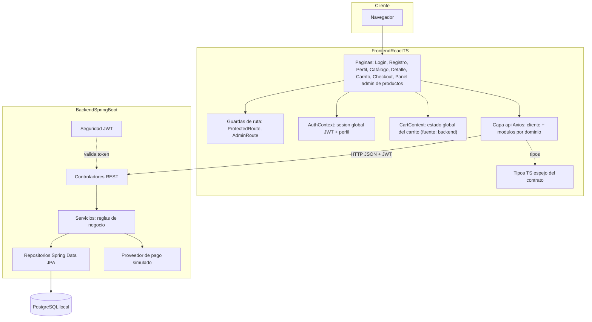
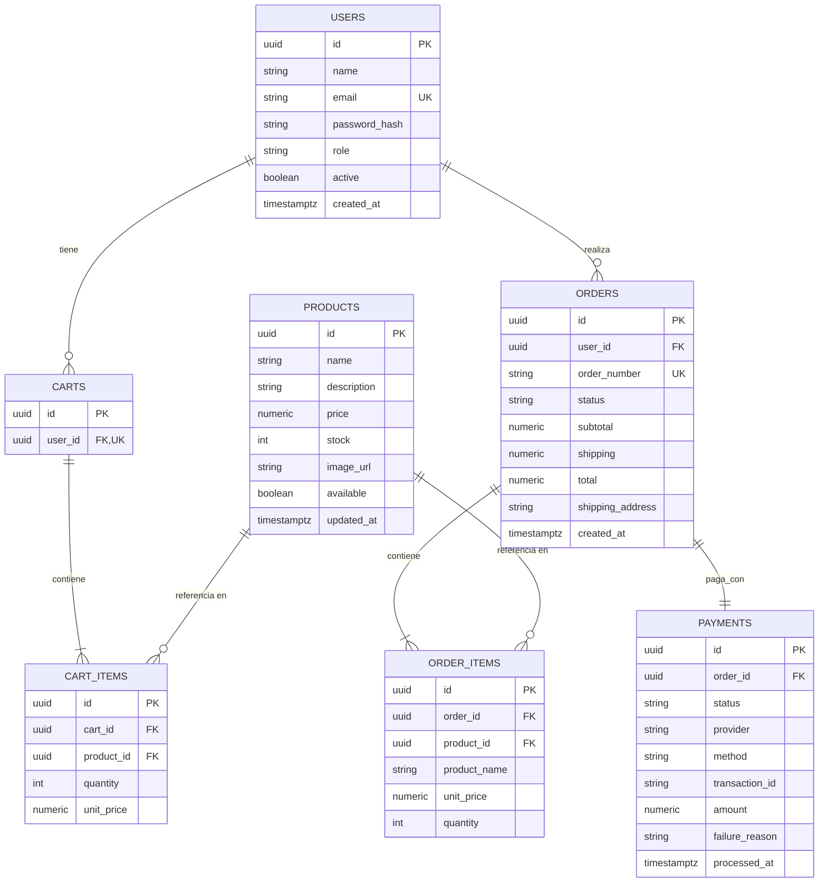
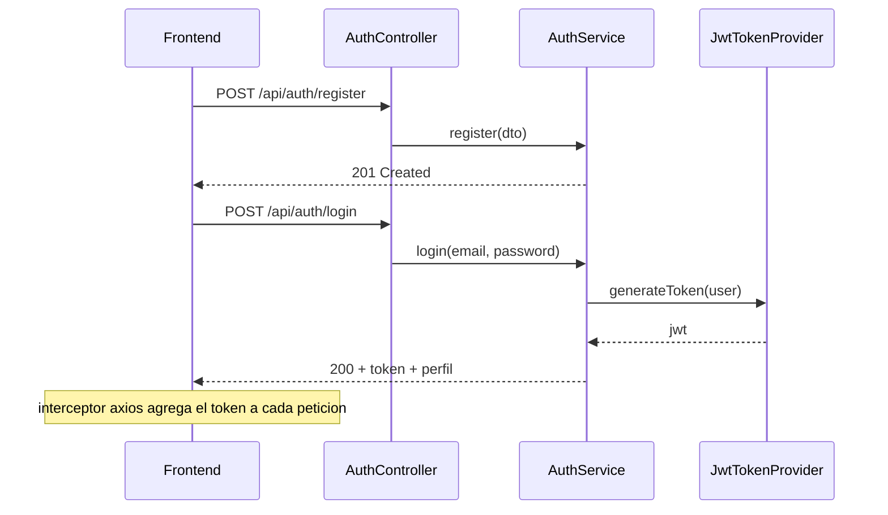

# Arquitectura — E-commerce simplificado con checkout

**Proyecto:** Prueba técnica para la asignatura **Ingeniería de Software II (Ingesoft II)**
**Stack:** Java 17 · Spring Boot 3.5 · React 18 + TypeScript · PostgreSQL
**Alcance:** MVP local, ejecutable con scripts, listo para sustentación

## 1. Resumen

Tienda online con autenticación por roles (usuario/administrador), gestión CRUD de productos y stock, carrito de compras persistente, checkout con pago simulado y trazabilidad de órdenes. La arquitectura prioriza **capas bien separadas**, **interfaces que desacoplan módulos** y **documentación como entregable**, para cumplir los criterios de evaluación (buenas prácticas, SOLID, DRY, sustentación).

### 1.1 Trazabilidad de requerimientos

| # | Requerimiento | Módulo responsable | Evidencia | Estado |
|---|---------------|--------------------|-----------|--------|
| R1 | Autenticación y gestión de usuarios segura | `backend: auth` (JWT + BCrypt); `frontend: pages` (login, registro y perfil) | Endpoints `/api/auth/*`, `/api/users/me`; páginas [`LoginPage.tsx`](../frontend/src/pages/LoginPage.tsx), [`RegisterPage.tsx`](../frontend/src/pages/RegisterPage.tsx), [`ProfilePage.tsx`](../frontend/src/pages/ProfilePage.tsx) | Implementado |
| R2 | CRUD productos, stock y órdenes para administradores | `backend: catalog` con `@PreAuthorize("hasRole('ADMIN')")`; `backend: orders` (gestión admin de órdenes con máquina de estados y restitución de stock); `frontend: pages/admin` (panel de productos) | Endpoints `/api/admin/products/**` (CRUD + stock), `GET /api/admin/orders`, `GET /api/admin/orders/{id}`, `PATCH /api/admin/orders/{id}/status`; panel [`AdminProductsPage.tsx`](../frontend/src/pages/admin/AdminProductsPage.tsx) (CRUD, stock y desactivación) | Implementado |
| R3 | Carrito y checkout fluidos | `backend: cart` (carrito persistente con validación de stock) + `backend: checkout` (`POST /api/checkout` transaccional con pago simulado); `frontend: api` (capa de datos `api/cart.ts`, `api/checkout.ts` + sesión), estado global [`CartContext`](../frontend/src/context/CartContext.tsx)/[`useCart`](../frontend/src/hooks/useCart.ts) y páginas [`CartPage.tsx`](../frontend/src/pages/CartPage.tsx) (edición del carrito), [`CheckoutPage.tsx`](../frontend/src/pages/CheckoutPage.tsx) (finalizar compra con pago simulado, F-4.1) y acciones de agregar en [`ProductCard.tsx`](../frontend/src/components/ProductCard.tsx) y [`ProductDetailPage.tsx`](../frontend/src/pages/ProductDetailPage.tsx) | Endpoints `GET /api/cart`, `POST /api/cart/items`, `PATCH|DELETE /api/cart/items/{itemId}`, `POST /api/checkout`; rutas `/` (tarjeta), `/product/:id` (detalle), `/cart` y `/checkout` (protegidas) | Implementado |
| R4 | Validaciones de stock y pagos | `CartServiceImpl` valida stock en agregar/actualizar; `CheckoutServiceImpl` re-valida stock bajo bloqueo pesimista (`INSUFFICIENT_STOCK`, `CART_EMPTY`) y procesa el pago simulado (`PAYMENT_DECLINED` → orden `PENDING`); el frontend muestra los rechazos de pago con una pantalla específica ([`CheckoutPage.tsx`](../frontend/src/pages/CheckoutPage.tsx)) | Endpoints de carrito y de checkout + códigos `INSUFFICIENT_STOCK`, `CART_EMPTY`, `PAYMENT_DECLINED` | Implementado |
| R5 | Interfaz clara de productos y detalles | `backend: catalog` (catálogo público); `frontend: pages` (catálogo y detalle) con componentes compartidos de la UI ([`CatalogPage.tsx`](../frontend/src/pages/CatalogPage.tsx), [`ProductDetailPage.tsx`](../frontend/src/pages/ProductDetailPage.tsx)) | Endpoints `GET /api/products`, `GET /api/products/{id}`; rutas `/` y `/product/:id` | Implementado |

### 1.2 Criterios de evaluación → estrategia

| Criterio | Cómo se cumple |
|----------|----------------|
| Buenas prácticas | Convenciones por capas, DTOs de entrada/salida, manejo global de errores, validación con Bean Validation, Checkstyle en el build |
| Sustentación | Arquitectura por capas, diagramas, ADRs en [`decisiones-adr.md`](decisiones-adr.md) y evidencias de código en [`solid-dry.md`](solid-dry.md) |
| Pruebas unitarias | JUnit 5 + Mockito en backend, Vitest + RTL en frontend |

## 3. Visión general de la arquitectura



### 3.1 Capas backend y regla de dependencias

```
Controller → Service (interface) → Repository → Database
      ↓              ↓
     DTO        Entity/DTO
```

- Los **controladores** solo traducen HTTP → DTO → servicio → HTTP. No contienen reglas de negocio.
- Los **servicios** se programan contra **interfaces** (`IProductService`, `ICartService`, `ICheckoutService`, `IOrderService`, `IOrderAdminService`, `IPaymentProvider`); la implementación se inyecta por el contenedor.
- Los **repositorios** son la única capa que conoce a las entidades JPA. Los servicios devuelven DTOs hacia afuera (la entidad no "fuga" fuera de la capa de datos).
- **Paginación y búsqueda** vía `Pageable` de Spring Data, no en el controlador.
- **Calidad de código:** Checkstyle corre en la fase `validate` del build (severidad `warning` ya rompe el build), configuración en [`checkstyle.xml`](../backend/checkstyle.xml).

### 3.2 Capas frontend y regla de dependencias

El frontend es una SPA (**React 18 + TypeScript + Vite**) en [`frontend/`](../frontend), con
**React Router** para el ruteo y **Axios** como único cliente HTTP:

```
Página / Componente → api/* (funciones por dominio) → client.ts (Axios) → Backend
        ↓                    ↓
  context/hooks        types/* (espejo del contrato)
```

- **Capa de datos única** ([`api/`](../frontend/src/api)): un módulo por dominio de la API
  (`auth.ts`, `products.ts`, `cart.ts`, `checkout.ts`, `orders.ts`, `admin.ts`).
  Ningún componente usa Axios directamente: siempre consume `api/*` (DRY, §8).
- **Tipos espejo del contrato** ([`types/`](../frontend/src/types)): cada interfaz declara el
  DTO de backend que refleja (p. ej. [`types/api.ts`](../frontend/src/types/api.ts) espeja
  `ApiError` y `Page<T>` de Spring Data). El contrato de errores del backend se vuelve un
  error tipado ([`ApiError`](../frontend/src/api/client.ts) en [`client.ts`](../frontend/src/api/client.ts))
  con `code` y `message` listos para mostrarse textualmente en la UI.
- **Sesión global** ([`AuthContext.tsx`](../frontend/src/context/AuthContext.tsx), acceso vía
  [`useAuth`](../frontend/src/hooks/useAuth.ts)): única fuente de verdad de la sesión.
  Persiste el JWT (clave `shop_token`) y un perfil cacheado (`shop_profile`) para pintar la
  UI sin esperar la red; al montar valida el token con `GET /users/me` y el backend
  siempre prevalece. El interceptor de [`client.ts`](../frontend/src/api/client.ts) inyecta el
  JWT en cada petición y, ante `401` (salvo en el propio login), limpia la sesión y
  redirige a `/login`.
- **Guardas de ruta:** [`ProtectedRoute`](../frontend/src/components/ProtectedRoute.tsx) exige
  sesión (redirige a `/login` guardando la ruta de origen);
  [`AdminRoute`](../frontend/src/components/AdminRoute.tsx) exige además rol `ADMIN` y muestra
  una pantalla 403 explícita. Mientras se valida el token persistido (`loading`), la
  navegación queda en estado de espera: evita el "destello" de enlaces o 403 equivocados.
- **Navegación por sesión** ([`Navbar.tsx`](../frontend/src/components/Navbar.tsx)): rama
  anónima (login/registro) vs. autenticada (carrito con insignia de cantidad, órdenes,
  perfil, panel admin solo si `role === 'ADMIN'`).
- **Contrato de red del monorepo:** el dev server de Vite corre en el puerto **5173 fijo**
  ([`vite.config.ts`](../frontend/vite.config.ts)) porque el CORS del backend apunta a
  `http://localhost:5173`; la URL base de la API se configura con `VITE_API_URL`
  (default `http://localhost:8080/api`).
- **Calidad de código:** ESLint + Prettier (`npm run lint` / `npm run format` en
  [`frontend/`](../frontend)).

> **Estado actual del frontend:** implementados la infraestructura (Vite/TS/ESLint), la capa
> de datos completa para todos los dominios de la API, la sesión global, el estado global
> del carrito ([`CartContext`](../frontend/src/context/CartContext.tsx)/[`useCart`](../frontend/src/hooks/useCart.ts), §3.5),
> las guardas de ruta, el mapa de rutas ([`App.tsx`](../frontend/src/App.tsx)), las páginas de
> autenticación (login, registro y perfil, §3.3), las páginas de catálogo, detalle de producto
> y panel admin de productos (§3.4), la página de carrito con las acciones de «Agregar al
> carrito» en catálogo y detalle (§3.5) y la página de checkout con pago simulado
> (§3.6); las páginas restantes (órdenes y panel admin de órdenes) están en
> desarrollo con placeholders que describen su comportamiento objetivo.

### 3.3 Páginas de autenticación implementadas

Las primeras páginas de la UI (rutas `/login`, `/register` y `/profile` en
[`App.tsx`](../frontend/src/App.tsx)) siguen la misma regla de dependencias que
el resto de la SPA: consumen `api/*`, [`useAuth`](../frontend/src/hooks/useAuth.ts) y los
tipos espejo; ningún componente habla con Axios directamente.

| Página | Ruta | Comportamiento |
|--------|------|----------------|
| [`LoginPage`](../frontend/src/pages/LoginPage.tsx) | `/login` | Validación en cliente (email y contraseña obligatorios); si ya hay sesión, redirige por rol (`ADMIN` → `/admin/products`, `USER` → `/`); los errores del backend (p. ej. 401 `INVALID_CREDENTIALS`) se muestran textualmente; incluye las cuentas demo del seed |
| [`RegisterPage`](../frontend/src/pages/RegisterPage.tsx) | `/register` | Validación espejo de `RegisterRequest` (nombre ≤ 100, contraseña 8–72, confirmación); `POST /api/auth/register` → `201`; el 409 `EMAIL_ALREADY_REGISTERED` se muestra textualmente; al éxito redirige a `/login` pasando el email registrado en `state` |
| [`ProfilePage`](../frontend/src/pages/ProfilePage.tsx) | `/profile` (tras [`ProtectedRoute`](../frontend/src/components/ProtectedRoute.tsx)) | Muestra rol y fecha de alta; edición de nombre, email y contraseña vía `PUT /api/users/me` (contraseña vacía → `null`, no se modifica); si el email cambia, el JWT (subject = email anterior) deja de ser válido: se avisa al usuario y la sesión se cierra a los 2 s para volver a `/login` |

Convenciones comunes a las tres páginas:

- **Doble validación:** la validación en cliente duplica las reglas de Bean
  Validation del backend para reducir la latencia percibida; el backend sigue
  siendo la autoridad (códigos de negocio + re-validación).
- **Errores del backend tal cual:** `ApiError.message` se muestra en un
  `<p role="alert">`; solo los errores no tipados muestran un mensaje genérico.
- **Estados por botón:** `submitting` deshabilita el envío y cambia la etiqueta
  ("Iniciando sesión…", "Creando cuenta…", "Guardando…").
- **Estilos por módulo:** [`LoginPage.module.css`](../frontend/src/styles/LoginPage.module.css),
  [`RegisterPage.module.css`](../frontend/src/styles/RegisterPage.module.css) y
  [`ProfilePage.module.css`](../frontend/src/styles/ProfilePage.module.css)
  (CSS Modules, sin estilos globales por página).

### 3.4 Catálogo, detalle de producto y panel admin de productos

Las páginas nuevas (`/`, `/product/:id` y `/admin/products` en
[`App.tsx`](../frontend/src/App.tsx)) siguen la misma regla de dependencias que
el resto de la SPA: consumen `api/*`, [`useAuth`](../frontend/src/hooks/useAuth.ts)
y los tipos espejo; ningún componente habla con Axios directamente.

| Página | Ruta | Comportamiento |
|--------|------|----------------|
| [`CatalogPage`](../frontend/src/pages/CatalogPage.tsx) | `/` | Catálogo público paginado (`GET /api/products`, 10 por página) con búsqueda con debounce (400 ms); estados de carga, de error con botón «Reintentar» y vacío con «Limpiar búsqueda» cuando hay un filtro activo |
| [`ProductDetailPage`](../frontend/src/pages/ProductDetailPage.tsx) | `/product/:id` | Detalle del producto (`GET /api/products/{id}`): imagen con fallback, precio en COP y `updatedAt` en formato es-CO; la cantidad queda acotada al stock disponible; 404 → «Producto no encontrado»; «Agregar al carrito» (F-3.3): los usuarios autenticados agregan la cantidad seleccionada vía `useCart.add` con feedback de éxito y errores del backend textualmente; sin sesión, enlace a login |
| [`AdminProductsPage`](../frontend/src/pages/admin/AdminProductsPage.tsx) | `/admin/products` (tras [`AdminRoute`](../frontend/src/components/AdminRoute.tsx)) | Gestión de productos: tabla paginada que incluye desactivados, búsqueda, creación y edición vía [`ProductForm`](../frontend/src/components/admin/ProductForm.tsx), ajuste absoluto de stock en línea (entero ≥ 0, `PATCH .../stock`), desactivación con confirmación (soft delete) y mensaje de éxito que se oculta solo a los 4 s |

Componentes compartidos:

| Componente | Uso |
|------------|-----|
| [`ProductCard`](../frontend/src/components/ProductCard.tsx) | Tarjeta de la grilla del catálogo y del detalle: precio en COP con `Intl.NumberFormat` (es-CO), insignia de stock («Agotado», «Quedan N» cuando quedan ≤ 3, o «En stock»), imagen con `loading="lazy"` y fallback de error, y botón «Agregar al carrito» (F-3.3) que suma 1 unidad vía `useCart.add` con feedback de éxito (2 s) y errores del backend textualmente |
| [`Pagination`](../frontend/src/components/Pagination.tsx) | Navegación de páginas con ventana con elipsis y `aria-current`; se oculta cuando el resultado ocupa una sola página |
| [`EmptyState`](../frontend/src/components/EmptyState.tsx) | Estado vacío/error genérico (`role="status"`) con ranura para acciones |

Convenciones comunes a las tres páginas:

- **Guarda de carreras:** `requestIdRef` descarta las respuestas que llegan
  desordenadas (p. ej. un cambio de búsqueda con una petición anterior aún
  en curso).
- **Debounce de búsqueda:** 400 ms entre la última tecla y la petición.
- **Validación en cliente espejo del backend:** [`ProductForm`](../frontend/src/components/admin/ProductForm.tsx)
  refleja `ProductRequest` (nombre ≤ 150, descripción ≤ 2000, URL de imagen
  ≤ 500) y el stock valida entero ≥ 0; el backend sigue siendo la autoridad.
- **Errores del backend tal cual:** `ApiError.message` se muestra en un
  `<p role="alert">`; solo los errores no tipados muestran un mensaje genérico.
- **Estilos por módulo:** 7 CSS Modules nuevos
  ([`CatalogPage.module.css`](../frontend/src/styles/CatalogPage.module.css),
  [`ProductDetailPage.module.css`](../frontend/src/styles/ProductDetailPage.module.css),
  [`AdminProductsPage.module.css`](../frontend/src/styles/AdminProductsPage.module.css),
  [`ProductCard.module.css`](../frontend/src/styles/ProductCard.module.css),
  [`Pagination.module.css`](../frontend/src/styles/Pagination.module.css),
  [`EmptyState.module.css`](../frontend/src/styles/EmptyState.module.css) y
  [`ProductForm.module.css`](../frontend/src/styles/ProductForm.module.css)).

### 3.5 Carrito: estado global, página y acciones de agregar (F-3.1, F-3.2, F-3.3)

El módulo de carrito cierra el frontend del requerimiento R3. Sigue la misma
regla de dependencias que el resto de la SPA: las páginas y componentes
consumen la capa `api/*` y el contexto global; ningún componente habla con
Axios directamente.

**Estado global — [`CartContext`](../frontend/src/context/CartContext.tsx) (F-3.1, acceso vía [`useCart`](../frontend/src/hooks/useCart.ts)):**

- **El backend es la única fuente de verdad:** la persistencia vive en
  `/api/cart/**` (el carrito es por usuario y "persiste entre sesiones", R3);
  el contexto solo refleja el último `CartResponse` (ítems, `subtotal`
  calculado en el servidor, `itemCount`). No se almacena en `localStorage`.
- **Carga al iniciar sesión:** cuando `user` pasa de `null` a un perfil,
  realiza `GET /api/cart`; al cerrar sesión limpia el estado local. Un
  contador monótono (`requestIdRef`) descarta respuestas desordenadas ante
  cambios de sesión o recargas.
- **Mutaciones contra la API:** `add` (POST `/cart/items`), `update`
  (PATCH `/cart/items/{itemId}`) y `remove` (DELETE `/cart/items/{itemId}`).
  El backend devuelve el `CartResponse` completo, que reemplaza el estado:
  precios capturados por el servidor, subtotal y validación de stock (B-3.2).
- **Propagación de errores:** los errores de mutación (p. ej. 409
  `INSUFFICIENT_STOCK`) se propagan al componente llamador como `ApiError`,
  cuyo mensaje se muestra textualmente (misma convención de §3.3).

El proveedor se monta en [`main.tsx`](../frontend/src/main.tsx) dentro de
`AuthProvider` (depende de la sesión vía `useAuth`), siguiendo el mismo
patrón que `AuthContext`/`useAuth` (F-0.4).

**Páginas y componentes:**

| Elemento | Ubicación | Comportamiento |
|----------|-----------|----------------|
| [`CartPage`](../frontend/src/pages/CartPage.tsx) | `/cart` (tras [`ProtectedRoute`](../frontend/src/components/ProtectedRoute.tsx)) | Listado de ítems: enlace al producto, precio unitario, total de la línea, [`QuantitySelector`](../frontend/src/components/QuantitySelector.tsx) y botón «Quitar»; cada cambio se persiste vía `useCart.update` / `useCart.remove` con estado pendiente por ítem (controles deshabilitados) y errores por ítem textualmente; si el backend rechaza (409 `INSUFFICIENT_STOCK`), la UI conserva la cantidad confirmada por el servidor. El resumen muestra el subtotal del backend y avisa de que el envío se aplica al finalizar la compra. Estados: carga (spinner), error de carga (con «Reintentar»), vacío (`EmptyState` con CTA al catálogo) y edición. «Ir a checkout» lleva a `/checkout` (placeholder hasta F-4.1) |
| [`QuantitySelector`](../frontend/src/components/QuantitySelector.tsx) | Reutilizable (usado en `CartPage`) | Componente puro de presentación: input controlado limitado a `[min, max]` en el cliente (ergonomía; la validación real de stock vive en el backend), botones `+`/`−` y estado `busy` que deshabilita el control mientras la petición se persiste |
| Agregar — [`ProductCard`](../frontend/src/components/ProductCard.tsx) | Catálogo (`/`) | «Agregar al carrito» suma 1 unidad vía `useCart.add` (la tarjeta no trae selector de cantidad); feedback de éxito de 2 s sobre el botón («Agregado ✓»); mensaje del backend textual ante rechazos; sin sesión, enlace a login. La guarda `productIdRef` descarta respuestas de adds obsoletas si la tarjeta se reutiliza para otro producto |
| Agregar — [`ProductDetailPage`](../frontend/src/pages/ProductDetailPage.tsx) | `/product/:id` | Selector de cantidad (acotado al stock) + «Agregar al carrito» que suma la cantidad elegida vía `useCart.add`; mismos feedback y manejo de errores que `ProductCard` |

Convenciones:

- **Sin validación de stock en cliente:** los controles de cantidad solo
  acotan por ergonomía; la autoridad es `CartServiceImpl`
  (409 `INSUFFICIENT_STOCK`) — R4.
- **Guardas de carrera:** `requestIdRef` (contexto) y `productIdRef`
  (tarjeta/detalle) descartan respuestas desordenadas ante cambios de sesión
  o de producto.
- **Estado pendiente por ítem:** mientras un ítem tiene una mutación en
  vuelo, sus controles quedan deshabilitados para evitar peticiones
  duplicadas.
- **Estilos por módulo:** 2 CSS Modules nuevos
  ([`CartPage.module.css`](../frontend/src/styles/CartPage.module.css) y
  [`QuantitySelector.module.css`](../frontend/src/styles/QuantitySelector.module.css)).

### 3.6 Checkout: finalizar compra con pago simulado (F-4.1)

El módulo de checkout cierra el frontend del requerimiento R3 y consume el
endpoint `POST /api/checkout` ya documentado en §4.6 de [`api.md`](api.md).
Sigue la misma regla de dependencias que el resto de la SPA: consume la capa
[`api/checkout.ts`](../frontend/src/api/checkout.ts) y
[`useCart`](../frontend/src/hooks/useCart.ts); ningún componente habla con
Axios directamente.

| Elemento | Ubicación | Comportamiento |
|----------|-----------|----------------|
| [`CheckoutPage`](../frontend/src/pages/CheckoutPage.tsx) | `/checkout` (tras [`ProtectedRoute`](../frontend/src/components/ProtectedRoute.tsx)) | Formulario en dos secciones — «1 · Dirección de envío» (textarea, ≤ 255) y «2 · Pago» (método `Visa`/`Mastercard`/`PSE`, número de tarjeta y titular) — con un resumen del pedido a la derecha (ítems con `lineTotal`, subtotal del backend, envío fijo y total). Estados: carga del carrito (spinner), error de carga (con «Reintentar»), carrito vacío ([`EmptyState`](../frontend/src/components/EmptyState.tsx) con CTA al catálogo), formulario, éxito y rechazo |
| Pantalla de éxito | Tras `201` | Muestra `orderNumber` y `total` pagado; llama a `useCart.refresh()` (el backend ya dejó el carrito vacío); CTAs «Ver mis órdenes» (`/orders`, aún placeholder) y «Seguir comprando» (`/`) |
| Pantalla de pago rechazado | `402 PAYMENT_DECLINED` | Muestra el mensaje del backend tal cual y el `orderNumber` extraído del mensaje (regex `ORD-…`); informa que la orden quedó `PENDING`, que el stock no se descontó y que puede reintentar con otra tarjeta; CTAs «Reintentar el pago» (vuelve al formulario) y «Volver al catálogo» |
| Otros errores | Cualquier otro `ApiError` | `ApiError.message` en un `<p role="alert">` bajo el formulario (misma convención de §3.3); solo los errores no tipados muestran un mensaje genérico |

Convenciones:

- **Envío fijo:** la constante `SHIPPING_FEE = 5000` del componente espeja
  el `checkout.shipping-fee` del backend (envío fijo, §4.6 de
  [`api.md`](api.md)); el total que confirma la compra es el de la
  respuesta `OrderResponse`, no el del resumen local.
- **Validación en cliente espejo del backend:** dirección obligatoria
  (≤ 255), método obligatorio (≤ 30), número de tarjeta de 13–19 dígitos
  (≤ 25 caracteres); el backend sigue siendo la autoridad.
- **Formateo de tarjeta:** el input de tarjeta acepta solo dígitos, se
  agrupa en bloques de 4 mientras se escribe (máx. 19) y usa
  `inputMode="numeric"` / `autoComplete="cc-number"`.
- **Ayuda de demo:** el hint del input de tarjeta indica que las tarjetas
  terminadas en `0002` son rechazadas por la pasarela simulada (para
  demostrar el flujo de rechazo, §4.6 de [`api.md`](api.md)).
- **Fuente de verdad del resumen:** los ítems, el subtotal y el total se
  derivan de `useCart`; la página no recalcula precios.
- **Estados por botón:** `submitting` deshabilita el envío y cambia la
  etiqueta ("Procesando pago…").
- **Ruta protegida:** `/checkout` pasó de pública (placeholder) a protegida
  con [`ProtectedRoute`](../frontend/src/components/ProtectedRoute.tsx) en
  [`App.tsx`](../frontend/src/App.tsx); el botón «Ir a checkout» de
  [`CartPage`](../frontend/src/pages/CartPage.tsx) ya no apunta a un
  placeholder.
- **Estilos por módulo:** 1 CSS Module nuevo
  ([`CheckoutPage.module.css`](../frontend/src/styles/CheckoutPage.module.css)).

## 4. Diseño de base de datos



El esquema implementado en [`V1__init.sql`](../backend/src/main/resources/db/migration/V1__init.sql) coincide con este ER. **Decisiones clave** (registro completo en [`decisiones-adr.md`](decisiones-adr.md)):

| Decisión | Justificación | ADR |
|----------|---------------|-----|
| `ORDER_ITEMS` denormaliza `product_name` y `unit_price` | Una orden es un **histórico inmutable**: si el admin cambia el precio o el nombre después, la orden no se modifica | ADR-008 |
| `CART_ITEMS.unit_price` se captura al momento de agregar | El carrito refleja el precio vigente cuando el usuario agregó el producto; se re-valida en checkout | ADR-009 |
| `PAYMENTS` con `transaction_id` y `failure_reason` | Trazabilidad: se puede demostrar el flujo de pago rechazado con evidencia | ADR-007 |
| Enums de dominio como `VARCHAR` + `CHECK` | Portabilidad PostgreSQL/H2 (H2 no soporta `CREATE TYPE ... AS ENUM`) | ADR-004 |
| Índices en `orders.user_id`, `orders.status`, `products.available`, `cart_items.cart_id` | Consultas frecuentes (mis órdenes, listado admin, catálogo activo, carga de carrito) | ADR-002 |
| `CART_ITEMS` con restricción única `cart_id + product_id` | Un producto aparece una sola vez por carrito: re-agregarlo **acumula** la cantidad en lugar de duplicar el ítem (ADR-014) | ADR-014 |

**Migraciones con Flyway** (`V1__init.sql`, `V2__seed.sql`): esquema versionado, reproducible y dueño único del esquema (`ddl-auto: validate`). Seed determinístico: 1 admin, 1 usuario y 8 productos (uno con stock bajo para demostrar `INSUFFICIENT_STOCK`).

## 5. Seguridad (R1)

- **JWT** HS256 con expiración de 2 h (configurable en `application.yml`). El token se emite en `/api/auth/login` y se envía en header `Authorization: Bearer <token>`.
- **BCrypt** para hashes de contraseña (nunca en texto plano; fuerza 10).
- **Roles:** `USER` y `ADMIN`. Rutas admin protegidas con `@PreAuthorize("hasRole('ADMIN')")` (habilitado con `@EnableMethodSecurity` en [`SecurityConfig.java`](../backend/src/main/java/com/ingesoft/shop/config/SecurityConfig.java)); `/api/users/me` solo con el propio JWT.
- **CORS** restringido al origen del frontend local (`http://localhost:5173`).
- **Validación de entrada** en registro/login (email válido, longitud de contraseña) con Bean Validation.



## 6. Contrato API

Base URL: `http://localhost:8080/api`. La referencia completa por endpoint con ejemplos `curl`, formato de error y códigos de negocio está en [`api.md`](api.md). Resumen:

| Dominio | Endpoints | Acceso |
|---------|-----------|--------|
| Auth | `POST /auth/register`, `POST /auth/login` | Público |
| Users | `GET /users/me`, `PUT /users/me` | Usuario |
| Products | `GET /products`, `GET /products/{id}` | Público |
| Products (admin) | `GET/POST /admin/products`, `PUT/DELETE /admin/products/{id}`, `PATCH /admin/products/{id}/stock` | Admin |
| Cart | `GET /cart`, `POST /cart/items`, `PATCH /cart/items/{itemId}`, `DELETE /cart/items/{itemId}` | Usuario |
| Checkout | `POST /checkout` | Usuario |
| Orders (usuario) | `GET /orders/mine`, `GET /orders/mine/{id}` | Usuario |
| Orders (admin) | `GET /admin/orders`, `GET /admin/orders/{id}`, `PATCH /admin/orders/{id}/status` | Admin |
| Docs | `/swagger-ui.html` | Público |

**Formato de error estándar** (todo el backend responde igual):

```json
{
  "status": 409,
  "code": "INSUFFICIENT_STOCK",
  "message": "El producto 'Cable USB-C' no tiene suficiente stock (disponible: 2, solicitado: 5)",
  "timestamp": "2026-11-09T23:00:00Z"
}
```

Códigos de negocio: `EMAIL_ALREADY_REGISTERED`, `INVALID_CREDENTIALS`, `PRODUCT_NOT_FOUND`, `INSUFFICIENT_STOCK`, `CART_EMPTY`, `PAYMENT_DECLINED`, `ORDER_NOT_FOUND`, `FORBIDDEN`, `ORDER_STATUS_INVALID`.


## 7. Manejo de errores y calidad

- **Backend:** `@ControllerAdvice` global → excepciones de negocio (`BusinessException` con código) mapeadas al formato; `400` para validación, `401/403` para seguridad, `404` para no encontrado, `409` para conflictos de stock/estado, `402` para pago rechazado.
- **Transaccionalidad:** `@Transactional` en operaciones que tocan stock+orden+pago (p. ej. `PaymentServiceImpl`); el checkout usa `TransactionTemplate` para delimitar el programa-todo-o-nada y lanzar el `402 PAYMENT_DECLINED` **fuera** de la transacción (la orden `PENDING` y el pago `FAILED` sí se persisten). Rollback automático ante cualquier excepción de negocio.
- **Frontend:** interceptores centralizados de Axios, estados de carga/error/vacío en cada página de listado, mensajes de error del backend mostrados textualmente.
- **Linters:** Checkstyle (backend, **ya activo** en la fase `validate` del build) + ESLint + Prettier.

## 8. Estrategia de pruebas

> Estrategia planificada: aún no hay tests en el repositorio; se escriben conforme se avanza por módulo.

| Capa | Herramienta | Casos prioritarios |
|------|-------------|--------------------|
| Servicios backend | JUnit 5 + Mockito | `CartService`: stock insuficiente al agregar/actualizar (`INSUFFICIENT_STOCK`), acumulación de cantidad, subtotal correcto, ítem ajeno al carrito → 404; `CheckoutService`: stock insuficiente, pago rechazado (se conserva `PENDING`), éxito (stock descontado y carrito vacío); `OrderAdminService`: transición válida (`PAID → SHIPPED`), transición inválida → `ORDER_STATUS_INVALID` (`DELIVERED → SHIPPED`), cancelación `PAID → CANCELLED` repone el stock; `OrderService`: orden ajena al usuario → `ORDER_NOT_FOUND`; `PaymentService`: mapeo de estados; `ProductService`: validaciones de creación/actualización; `AuthService`: hash de contraseña y emisión de token |
| API backend | Spring Boot Test + MockMvc | Contrato de `/auth/register`, `/checkout` (409/402/201), permisos admin (403 a usuario común) |
| Componentes frontend | Vitest + React Testing Library | `ProductCard` (agregar al carrito), ítem de carrito (cambiar cantidad), `CheckoutPage` (formulario inválido, resultado de error) |

Cada test documenta **arrangement–action–assertion** y el requerimiento que cubre (comentario `// R4:`) → evidencia directa para la sustentación.

## 9. Riesgos y mitigaciones

| Riesgo | Mitigación |
|--------|-----------|
| PostgreSQL no instalado en la máquina de sustentación | Perfil `h2` en memoria (`--spring.profiles.active=h2`), **ya configurado** en `application.yml` y con H2 en `pom.xml` |
| Sobreventa por compras concurrentes | Bloqueo pesimista **implementado**: `findByCartIdForUpdate` y `findByIdForUpdate` (`PESSIMISTIC_WRITE`) en el checkout (ADR-015) + test de concurrencia pendiente |
| Alcance que crece en la sustentación | El MVP está acotado a §1.1; mejoras (gateway real, Docker, despliegue) se documentan como roadmap en los ADR, no se implementan |
| Diferencia de versiones JDK/Node | Maven wrapper en backend + `engines` en `package.json` + requisitos en README |

