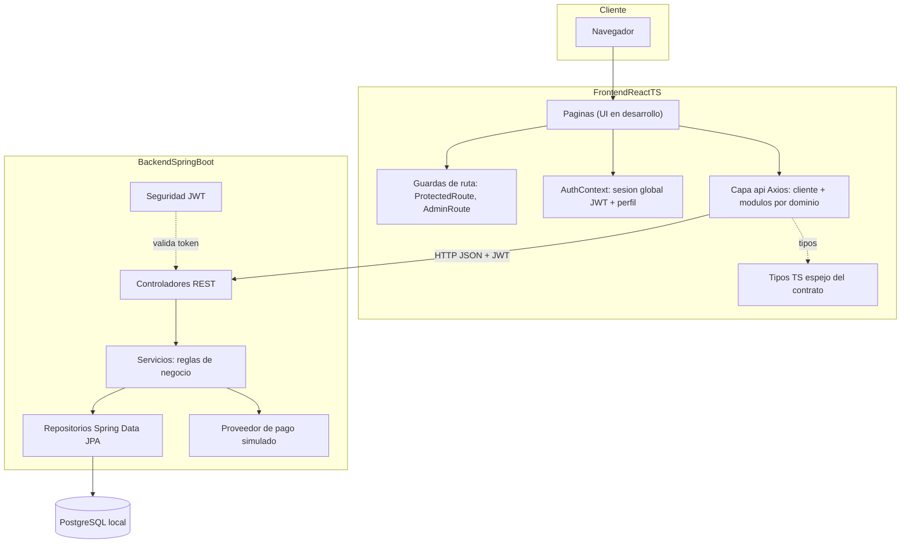
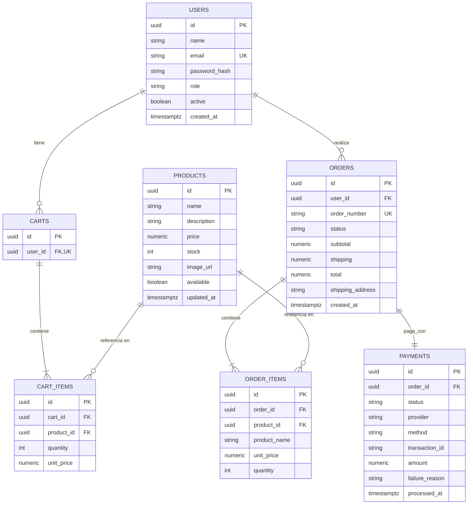
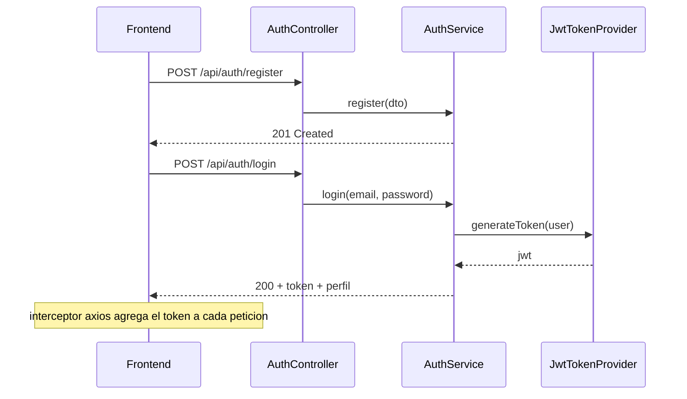

# Arquitectura — E-commerce simplificado con checkout

**Proyecto:** Prueba técnica para la asignatura **Ingeniería de Software II (Ingesoft II)**
**Stack:** Java 17 · Spring Boot 3.5 · React 18 + TypeScript · PostgreSQL
**Alcance:** MVP local, ejecutable con scripts, listo para sustentación

## 1. Resumen

Tienda online con autenticación por roles (usuario/administrador), gestión CRUD de productos y stock, carrito de compras persistente, checkout con pago simulado y trazabilidad de órdenes. La arquitectura prioriza **capas bien separadas**, **interfaces que desacoplan módulos** y **documentación como entregable**, para cumplir los criterios de evaluación (buenas prácticas, SOLID, DRY, sustentación).

### 1.1 Trazabilidad de requerimientos

| # | Requerimiento | Módulo responsable | Evidencia | Estado |
|---|---------------|--------------------|-----------|--------|
| R1 | Autenticación y gestión de usuarios segura | `backend: auth` (JWT + BCrypt) | Endpoints `/api/auth/*`, `/api/users/me` | Implementado |
| R2 | CRUD productos, stock y órdenes para administradores | `backend: catalog` con `@PreAuthorize("hasRole('ADMIN')")`; `backend: orders` (gestión admin de órdenes con máquina de estados y restitución de stock) | Endpoints `/api/admin/products/**` (CRUD + stock), `GET /api/admin/orders`, `GET /api/admin/orders/{id}`, `PATCH /api/admin/orders/{id}/status` | Implementado |
| R3 | Carrito y checkout fluidos | `backend: cart` (carrito persistente con validación de stock) + `backend: checkout` (`POST /api/checkout` transaccional con pago simulado); `frontend: api` (capa de datos `api/cart.ts`, `api/checkout.ts` + sesión); páginas de UI en desarrollo | Endpoints `GET /api/cart`, `POST /api/cart/items`, `PATCH|DELETE /api/cart/items/{itemId}`, `POST /api/checkout` | Parcial (backend completo; frontend con capa de datos y sesión lista, UI en desarrollo) |
| R4 | Validaciones de stock y pagos | `CartServiceImpl` valida stock en agregar/actualizar; `CheckoutServiceImpl` re-valida stock bajo bloqueo pesimista (`INSUFFICIENT_STOCK`, `CART_EMPTY`) y procesa el pago simulado (`PAYMENT_DECLINED` → orden `PENDING`) | Endpoints de carrito y de checkout + códigos `INSUFFICIENT_STOCK`, `CART_EMPTY`, `PAYMENT_DECLINED` | Implementado (backend) |
| R5 | Interfaz clara de productos y detalles | `backend: catalog` (catálogo público); `frontend: api` (capa de datos `api/products.ts`, tipos `types/product.ts` y rutas públicas); páginas de UI en desarrollo | Endpoints `GET /api/products`, `GET /api/products/{id}` | Parcial (frontend con capa de datos lista, UI en desarrollo) |

### 1.2 Criterios de evaluación → estrategia

| Criterio | Cómo se cumple |
|----------|----------------|
| Buenas prácticas | Convenciones por capas, DTOs de entrada/salida, manejo global de errores, validación con Bean Validation, Checkstyle en el build |
| Sustentación | Arquitectura por capas, diagramas, ADRs en [`decisiones-adr.md`](decisiones-adr.md) y evidencias de código en [`solid-dry.md`](solid-dry.md) |
| Pruebas unitarias | JUnit 5 + Mockito en backend, Vitest + RTL en frontend |

## 3. Visión general de la arquitectura



### 3.1 Capas backend y regla de dependencias

```
Controller → Service (interface) → Repository → Database
      ↓              ↓
     DTO        Entity/DTO
```

- Los **controladores** solo traducen HTTP → DTO → servicio → HTTP. No contienen reglas de negocio.
- Los **servicios** se programan contra **interfaces** (`IProductService`, `ICartService`, `ICheckoutService`, `IOrderService`, `IOrderAdminService`, `IPaymentProvider`); la implementación se inyecta por el contenedor.
- Los **repositorios** son la única capa que conoce a las entidades JPA. Los servicios devuelven DTOs hacia afuera (la entidad no "fuga" fuera de la capa de datos).
- **Paginación y búsqueda** vía `Pageable` de Spring Data, no en el controlador.
- **Calidad de código:** Checkstyle corre en la fase `validate` del build (severidad `warning` ya rompe el build), configuración en [`checkstyle.xml`](../backend/checkstyle.xml).

### 3.2 Capas frontend y regla de dependencias

El frontend es una SPA (**React 18 + TypeScript + Vite**) en [`frontend/`](../frontend), con
**React Router** para el ruteo y **Axios** como único cliente HTTP:

```
Página / Componente → api/* (funciones por dominio) → client.ts (Axios) → Backend
        ↓                    ↓
  context/hooks        types/* (espejo del contrato)
```

- **Capa de datos única** ([`api/`](../frontend/src/api)): un módulo por dominio de la API
  (`auth.ts`, `products.ts`, `cart.ts`, `checkout.ts`, `orders.ts`, `admin.ts`).
  Ningún componente usa Axios directamente: siempre consume `api/*` (DRY, §8).
- **Tipos espejo del contrato** ([`types/`](../frontend/src/types)): cada interfaz declara el
  DTO de backend que refleja (p. ej. [`types/api.ts`](../frontend/src/types/api.ts) espeja
  `ApiError` y `Page<T>` de Spring Data). El contrato de errores del backend se vuelve un
  error tipado ([`ApiError`](../frontend/src/api/client.ts) en [`client.ts`](../frontend/src/api/client.ts))
  con `code` y `message` listos para mostrarse textualmente en la UI.
- **Sesión global** ([`AuthContext.tsx`](../frontend/src/context/AuthContext.tsx), acceso vía
  [`useAuth`](../frontend/src/hooks/useAuth.ts)): única fuente de verdad de la sesión.
  Persiste el JWT (clave `shop_token`) y un perfil cacheado (`shop_profile`) para pintar la
  UI sin esperar la red; al montar valida el token con `GET /users/me` y el backend
  siempre prevalece. El interceptor de [`client.ts`](../frontend/src/api/client.ts) inyecta el
  JWT en cada petición y, ante `401` (salvo en el propio login), limpia la sesión y
  redirige a `/login`.
- **Guardas de ruta:** [`ProtectedRoute`](../frontend/src/components/ProtectedRoute.tsx) exige
  sesión (redirige a `/login` guardando la ruta de origen);
  [`AdminRoute`](../frontend/src/components/AdminRoute.tsx) exige además rol `ADMIN` y muestra
  una pantalla 403 explícita. Mientras se valida el token persistido (`loading`), la
  navegación queda en estado de espera: evita el "destello" de enlaces o 403 equivocados.
- **Navegación por sesión** ([`Navbar.tsx`](../frontend/src/components/Navbar.tsx)): rama
  anónima (login/registro) vs. autenticada (carrito con insignia de cantidad, órdenes,
  perfil, panel admin solo si `role === 'ADMIN'`).
- **Contrato de red del monorepo:** el dev server de Vite corre en el puerto **5173 fijo**
  ([`vite.config.ts`](../frontend/vite.config.ts)) porque el CORS del backend apunta a
  `http://localhost:5173`; la URL base de la API se configura con `VITE_API_URL`
  (default `http://localhost:8080/api`).
- **Calidad de código:** ESLint + Prettier (`npm run lint` / `npm run format` en
  [`frontend/`](../frontend)).

> **Estado actual del frontend:** implementados la infraestructura (Vite/TS/ESLint), la capa
> de datos completa para todos los dominios de la API, la sesión global, las guardas de ruta
> y el mapa de rutas ([`App.tsx`](../frontend/src/App.tsx)); las páginas de cada función
> (catálogo, detalle, carrito, checkout, perfil, órdenes y panel admin) están en
> desarrollo con placeholders que describen su comportamiento objetivo.

## 4. Diseño de base de datos



El esquema implementado en [`V1__init.sql`](../backend/src/main/resources/db/migration/V1__init.sql) coincide con este ER. **Decisiones clave** (registro completo en [`decisiones-adr.md`](decisiones-adr.md)):

| Decisión | Justificación | ADR |
|----------|---------------|-----|
| `ORDER_ITEMS` denormaliza `product_name` y `unit_price` | Una orden es un **histórico inmutable**: si el admin cambia el precio o el nombre después, la orden no se modifica | ADR-008 |
| `CART_ITEMS.unit_price` se captura al momento de agregar | El carrito refleja el precio vigente cuando el usuario agregó el producto; se re-valida en checkout | ADR-009 |
| `PAYMENTS` con `transaction_id` y `failure_reason` | Trazabilidad: se puede demostrar el flujo de pago rechazado con evidencia | ADR-007 |
| Enums de dominio como `VARCHAR` + `CHECK` | Portabilidad PostgreSQL/H2 (H2 no soporta `CREATE TYPE ... AS ENUM`) | ADR-004 |
| Índices en `orders.user_id`, `orders.status`, `products.available`, `cart_items.cart_id` | Consultas frecuentes (mis órdenes, listado admin, catálogo activo, carga de carrito) | ADR-002 |
| `CART_ITEMS` con restricción única `cart_id + product_id` | Un producto aparece una sola vez por carrito: re-agregarlo **acumula** la cantidad en lugar de duplicar el ítem (ADR-014) | ADR-014 |

**Migraciones con Flyway** (`V1__init.sql`, `V2__seed.sql`): esquema versionado, reproducible y dueño único del esquema (`ddl-auto: validate`). Seed determinístico: 1 admin, 1 usuario y 8 productos (uno con stock bajo para demostrar `INSUFFICIENT_STOCK`).

## 5. Seguridad (R1)

- **JWT** HS256 con expiración de 2 h (configurable en `application.yml`). El token se emite en `/api/auth/login` y se envía en header `Authorization: Bearer <token>`.
- **BCrypt** para hashes de contraseña (nunca en texto plano; fuerza 10).
- **Roles:** `USER` y `ADMIN`. Rutas admin protegidas con `@PreAuthorize("hasRole('ADMIN')")` (habilitado con `@EnableMethodSecurity` en [`SecurityConfig.java`](../backend/src/main/java/com/ingesoft/shop/config/SecurityConfig.java)); `/api/users/me` solo con el propio JWT.
- **CORS** restringido al origen del frontend local (`http://localhost:5173`).
- **Validación de entrada** en registro/login (email válido, longitud de contraseña) con Bean Validation.



## 6. Contrato API

Base URL: `http://localhost:8080/api`. La referencia completa por endpoint con ejemplos `curl`, formato de error y códigos de negocio está en [`api.md`](api.md). Resumen:

| Dominio | Endpoints | Acceso |
|---------|-----------|--------|
| Auth | `POST /auth/register`, `POST /auth/login` | Público |
| Users | `GET /users/me`, `PUT /users/me` | Usuario |
| Products | `GET /products`, `GET /products/{id}` | Público |
| Products (admin) | `GET/POST /admin/products`, `PUT/DELETE /admin/products/{id}`, `PATCH /admin/products/{id}/stock` | Admin |
| Cart | `GET /cart`, `POST /cart/items`, `PATCH /cart/items/{itemId}`, `DELETE /cart/items/{itemId}` | Usuario |
| Checkout | `POST /checkout` | Usuario |
| Orders (usuario) | `GET /orders/mine`, `GET /orders/mine/{id}` | Usuario |
| Orders (admin) | `GET /admin/orders`, `GET /admin/orders/{id}`, `PATCH /admin/orders/{id}/status` | Admin |
| Docs | `/swagger-ui.html` | Público |

**Formato de error estándar** (todo el backend responde igual):

```json
{
  "status": 409,
  "code": "INSUFFICIENT_STOCK",
  "message": "El producto 'Cable USB-C' no tiene suficiente stock (disponible: 2, solicitado: 5)",
  "timestamp": "2026-11-09T23:00:00Z"
}
```

Códigos de negocio: `EMAIL_ALREADY_REGISTERED`, `INVALID_CREDENTIALS`, `PRODUCT_NOT_FOUND`, `INSUFFICIENT_STOCK`, `CART_EMPTY`, `PAYMENT_DECLINED`, `ORDER_NOT_FOUND`, `FORBIDDEN`, `ORDER_STATUS_INVALID`.


## 7. Manejo de errores y calidad

- **Backend:** `@ControllerAdvice` global → excepciones de negocio (`BusinessException` con código) mapeadas al formato; `400` para validación, `401/403` para seguridad, `404` para no encontrado, `409` para conflictos de stock/estado, `402` para pago rechazado.
- **Transaccionalidad:** `@Transactional` en operaciones que tocan stock+orden+pago (p. ej. `PaymentServiceImpl`); el checkout usa `TransactionTemplate` para delimitar el programa-todo-o-nada y lanzar el `402 PAYMENT_DECLINED` **fuera** de la transacción (la orden `PENDING` y el pago `FAILED` sí se persisten). Rollback automático ante cualquier excepción de negocio.
- **Frontend:** interceptores centralizados de Axios, estados de carga/error/vacío en cada página de listado, mensajes de error del backend mostrados textualmente.
- **Linters:** Checkstyle (backend, **ya activo** en la fase `validate` del build) + ESLint + Prettier.

## 8. Estrategia de pruebas

> Estrategia planificada: aún no hay tests en el repositorio; se escriben conforme se avanza por módulo.

| Capa | Herramienta | Casos prioritarios |
|------|-------------|--------------------|
| Servicios backend | JUnit 5 + Mockito | `CartService`: stock insuficiente al agregar/actualizar (`INSUFFICIENT_STOCK`), acumulación de cantidad, subtotal correcto, ítem ajeno al carrito → 404; `CheckoutService`: stock insuficiente, pago rechazado (se conserva `PENDING`), éxito (stock descontado y carrito vacío); `OrderAdminService`: transición válida (`PAID → SHIPPED`), transición inválida → `ORDER_STATUS_INVALID` (`DELIVERED → SHIPPED`), cancelación `PAID → CANCELLED` repone el stock; `OrderService`: orden ajena al usuario → `ORDER_NOT_FOUND`; `PaymentService`: mapeo de estados; `ProductService`: validaciones de creación/actualización; `AuthService`: hash de contraseña y emisión de token |
| API backend | Spring Boot Test + MockMvc | Contrato de `/auth/register`, `/checkout` (409/402/201), permisos admin (403 a usuario común) |
| Componentes frontend | Vitest + React Testing Library | `ProductCard` (agregar al carrito), ítem de carrito (cambiar cantidad), `CheckoutPage` (formulario inválido, resultado de error) |

Cada test documenta **arrangement–action–assertion** y el requerimiento que cubre (comentario `// R4:`) → evidencia directa para la sustentación.

## 9. Riesgos y mitigaciones

| Riesgo | Mitigación |
|--------|-----------|
| PostgreSQL no instalado en la máquina de sustentación | Perfil `h2` en memoria (`--spring.profiles.active=h2`), **ya configurado** en `application.yml` y con H2 en `pom.xml` |
| Sobreventa por compras concurrentes | Bloqueo pesimista **implementado**: `findByCartIdForUpdate` y `findByIdForUpdate` (`PESSIMISTIC_WRITE`) en el checkout (ADR-015) + test de concurrencia pendiente |
| Alcance que crece en la sustentación | El MVP está acotado a §1.1; mejoras (gateway real, Docker, despliegue) se documentan como roadmap en los ADR, no se implementan |
| Diferencia de versiones JDK/Node | Maven wrapper en backend + `engines` en `package.json` + requisitos en README |

